# PralAI

PralAI is a five-agent system for flood analysis. It gets Earth-observation and
weather data for an area, and it gives evidence for flood-response decisions.

| Agent | Nickname | Role |
|---|---|---|
| Argus | `Argus` | Argus Panoptes from Greek mythology - a thousand eyed giant. He is an Orchestrator - decomposes the task, routes it, synthesises the answer |
| Norwood | `norwood` | Inspired by Virginia Norwood - The Mother of Landsat - Satellite / Earth-observation expert |
| Monty | `monty` | A Python expert -- implementation, performance, debugging |
| Entro | `entro` | Uncertainty analyser -- confidence, error sources, what would tighten them |
| Chanakya | `chanakya` | Historic Indian Chief Advisor - Decision assistant for city planners |

The code uses the folder names `agents/argos/` for Argus and
`agents/citadel/` for Chanakya.

PralAI is one of three repositories:

| Repository | Contents |
|---|---|
| PralAI (this one) | The agents, the LangGraph graph, the workflows and the local console API. |
| [Second-brain---FloodalyserAI](https://github.com/dawasignor/Second-brain---FloodalyserAI) | The knowledge vault: agent prompts, flow cards, module templates and the knowledge and source notes. PralAI reads it through `VAULT_ROOT` and needs it to run. |
| [argos-console](https://github.com/dawasignor/argos-console) | The Argus Console, the browser front end for the local console API. |

## Workflows

A workflow is a Python function in `core/workflows/`. Only Monty runs
workflows. Argus selects the workflow and sends the parameters. The command
`python run.py --workflows` shows all registered workflows.

| Workflow | Purpose | Scientific sources | Docs |
|---|---|---|---|
| `fetch_place_context` | Gives the bounding box, region and mapped buildings for a place name | OpenStreetMap Nominatim; Olbricht, Overpass API; GDACS (switched off) -- [SOURCES 8](docs/SOURCES.md#8-gazetteer-and-disaster-register) | [fetch_place_context.md](docs/fetch_place_context.md) |
| `fetch_weather_data` | Gives a weather and soil-moisture time series for one point | Zippenfenig (2023) Open-Meteo; ECMWF IFS; Munoz-Sabater et al. (2021) ERA5-Land -- [SOURCES 1](docs/SOURCES.md#1-datasets) | [fetch_weather_data.md](docs/fetch_weather_data.md) |
| `fetch_weather_grid` | Gives gridded hourly weather and storm totals for a bounding box (thesis output 1) | Zippenfenig (2023) Open-Meteo; ECMWF IFS documentation; Hersbach et al. (2020) ERA5 -- [SOURCES 1](docs/SOURCES.md#1-datasets) | [fetch_weather_grid.md](docs/fetch_weather_grid.md) |
| `fetch_lulc_data` | Gives land-cover indices from the most recent clear Sentinel-2 scene | Drusch et al. (2012); ESA L2A ATBD; Main-Knorn et al. (2017) -- [SOURCES 1](docs/SOURCES.md#1-datasets), [6](docs/SOURCES.md#6-cloud-masking-and-scene-usability). Rouse et al. (1974); Zha et al. (2003); Gao (1996); Xu (2006); Wang and Qu (2007) -- [SOURCES 2](docs/SOURCES.md#2-spectral-indices) | [fetch_lulc_data.md](docs/fetch_lulc_data.md) |
| `fetch_terrain_data` | Gives elevation and slope for a bounding box | ESA and Airbus (2022) Copernicus DEM GLO-30 -- [SOURCES 1](docs/SOURCES.md#1-datasets); Horn (1981) -- [SOURCES 5](docs/SOURCES.md#5-algorithms) | [fetch_terrain_data.md](docs/fetch_terrain_data.md) |
| `fetch_permanent_water` | Gives the permanent and seasonal water baseline for a bounding box | Pekel et al. (2016) JRC Global Surface Water -- [SOURCES 1](docs/SOURCES.md#1-datasets) | [fetch_permanent_water.md](docs/fetch_permanent_water.md) |
| `rank_flood_products` | Ranks five near-real-time flood products for one event with TOPSIS (thesis outputs 3 and 4) | Hwang and Yoon (1981) TOPSIS -- [SOURCES 5](docs/SOURCES.md#5-algorithms); Wagner et al. (2026) GFM; NASA MODIS/VIIRS and OPERA DSWx documents S1-S11 -- [SOURCES 8b](docs/SOURCES.md#8b-nrt-flood-products-and-the-mcdm) | [rank_flood_products.md](docs/rank_flood_products.md) |
| `sensitivity_analysis` | Shows how far one criterion weight can move before the ranking changes (thesis output 5) | Triantaphyllou and Sanchez (1997); Spearman (1904); Kendall (1945) -- [SOURCES 5](docs/SOURCES.md#5-algorithms) | [sensitivity_analysis.md](docs/sensitivity_analysis.md) |
| `data_availability` | Shows which of the five NRT flood products observed the area on each day of the event, as a chart. Use it before the product ranking | EODC STAC (GFM); NASA CMR-STAC (OPERA DSWx, LANCE MCDWD and VCDWD); Open-Meteo (overpass cloud) -- [SOURCES 8c](docs/SOURCES.md#8c-nrt-product-availability-catalogues) | [data_availability.md](docs/data_availability.md) |
| `where_am_i` | Shows what the area is before any analysis, in any country: a map of the box, the provinces, districts, cities and towns in it, counts of mapped buildings, hospitals, schools, shops and substations, and the dams, reservoirs, gauges, water works, river crossings, industry and flood defences in or near it | OpenStreetMap tiles and Overpass API -- [SOURCES 8](docs/SOURCES.md#8-gazetteer-and-disaster-register) | [where_am_i.md](docs/where_am_i.md) |
| `accuracy_metrics` | Compares each NRT product with a reference flood map and gives one table of agreement metrics next to the TOPSIS rank. Entro explains the table | UNOSAT FL20251128LKA via HDX (CC BY-SA); Matthews (1975); Jaccard (1912); Van Rijsbergen (1979) -- [SOURCES 8d](docs/SOURCES.md#8d-validation-reference-and-agreement-metrics) | [accuracy_metrics.md](docs/accuracy_metrics.md) |

The three raster workflows (`fetch_lulc_data`, `fetch_terrain_data`,
`fetch_permanent_water`) also use the Copernicus DEM Water Body Mask. This mask
removes the sea from all AOI statistics.

[docs/WORKFLOWS.md](docs/WORKFLOWS.md) is the full catalogue.
[docs/SOURCES.md](docs/SOURCES.md) holds the full citation of each source.

### How the agents communicate

All workflows use the same basic path. The first diagram shows this path. The
other diagrams show each workflow. Monty writes to the experiment cache only
when the run names an experiment.

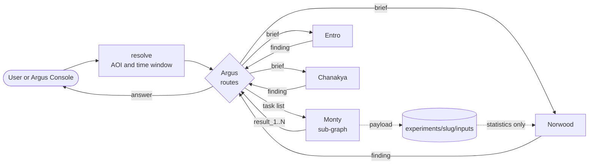

Argus is the only node that makes a decision. A specialist answers its brief
and then gives control back to Argus. `GRAPH_MAX_STEPS` sets the maximum number
of steps.

#### `fetch_place_context`

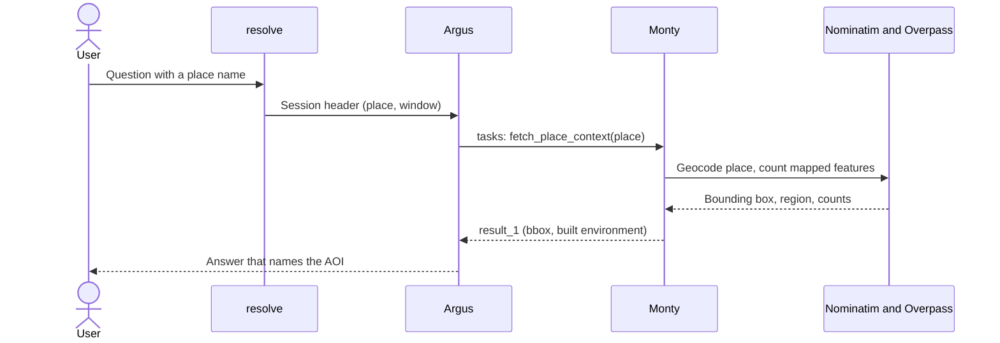

#### `fetch_weather_data`

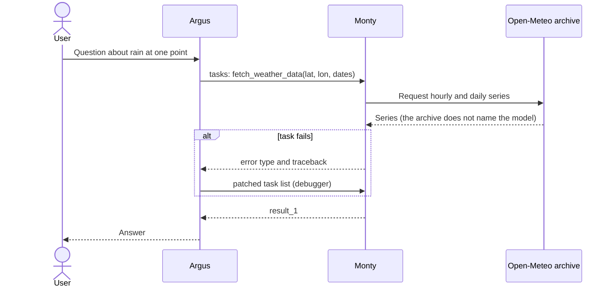

#### `fetch_weather_grid`

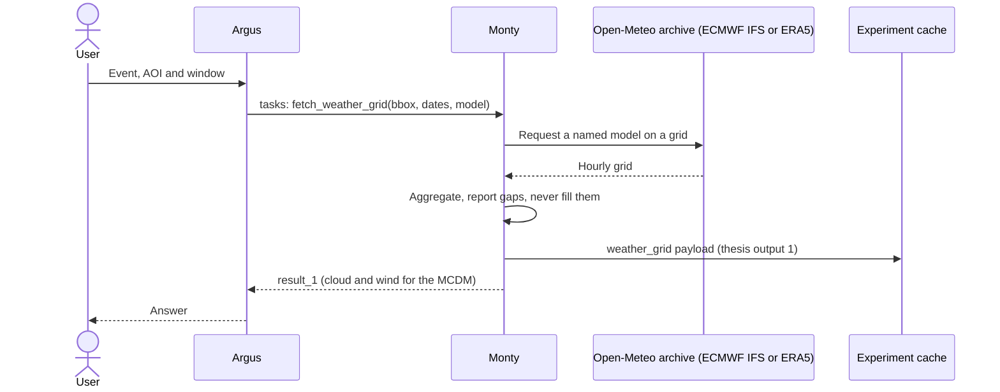

#### `fetch_lulc_data`

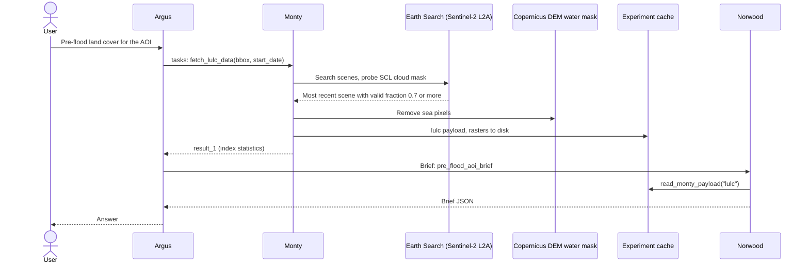

#### `fetch_terrain_data`

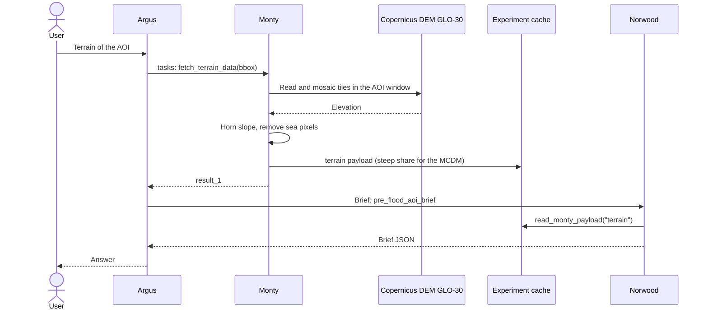

#### `fetch_permanent_water`

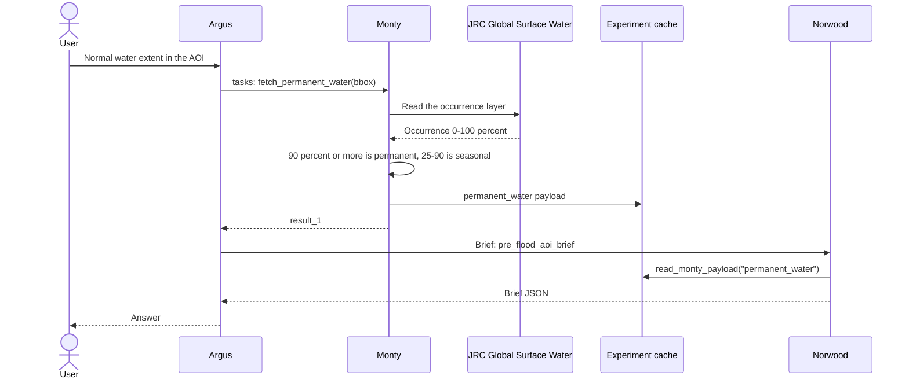

#### `rank_flood_products`

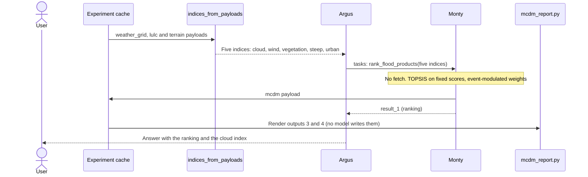

#### `sensitivity_analysis`

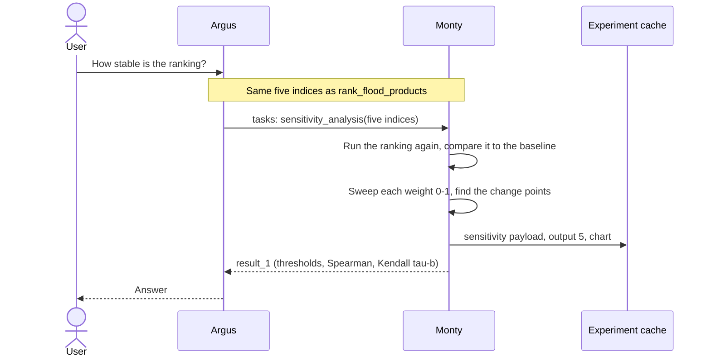

#### `data_availability`

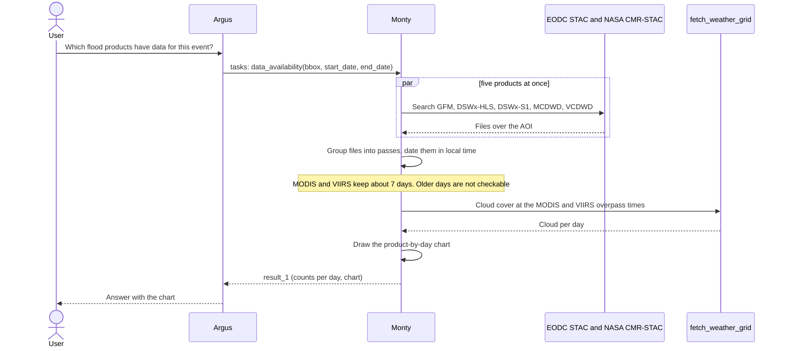

#### `accuracy_metrics`

Monty calculates the table. Entro explains it in the same run. This is the
only workflow whose result goes to a second agent before Argus answers.

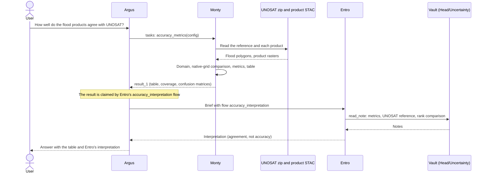

#### Planned: validation with a labelled sample

This process is partly built. The strata, the frozen draw, the image chips and
the labelling page exist; the estimators do not. It builds on
`accuracy_metrics`, above. The design is in
[docs/sample_reference.md](docs/sample_reference.md).

The process works for any AOI and any event window. The set of flood products
is not fixed. `data_availability` finds the products that observed the AOI in
the window, and only these products go into the strata and the tables. Each
other product gets a table row that gives the reason, for example
`not_checkable` or "needs an Earthdata login".

Solid boxes are workflows that exist. Dashed boxes are planned steps. The
parallelogram is the work of a person.

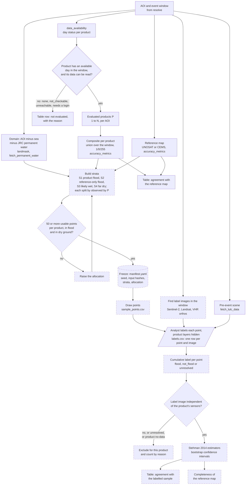

Rules for the plan:

1. Freeze the strata before a person labels a point. The manifest records the
   seed, the input hashes, the strata and the allocation.
2. The analyst does not see the product layers or the stratum of a point.
3. A label counts for a product only if its image does not come from a sensor
   that the product uses. For example, a Sentinel-2 label does not count for
   OPERA DSWx-HLS, and the plan uses no Sentinel-1 labels.
4. The code calculates the label of each point from `labels.csv`. A person does
   not type it. If the images cannot resolve a point, the code excludes the
   point and counts it. It does not guess.
5. The output has two tables: agreement with the reference map, and agreement
   with the labelled sample. It also gives the completeness of the reference
   map, with a confidence interval.

### Monty's sub-graph

Monty is not a chat agent. The `monty` node runs a sub-graph with four steps
(`core/monty_graph.py`):

1. Receive input.
2. Resolve each task against the registry.
3. Execute each task.
4. Return one `result_N` for each task.

Argus sends an `event_id` and a list of tasks:

```json
{"event_id": 42,
 "tasks": [{"function": "fetch_weather_data",
            "params": {"latitude": 55.9533, "longitude": -3.1883,
                       "start_date": "2026-08-18", "end_date": "2026-08-20"}}]}
```

Monty sends back one result for each task:

```json
{"result_1": {"task": "fetch_weather_data",
              "output": {"series": {"daily_rain": {"values": [0.2, 7.5, 2.0]}}},
              "status": "success",
              "message": "fetch_weather_data completed successfully",
              "error": null}}
```

A failed task does not stop the batch. Each task gets a `result_N`. The keys in
`params` must be the same as the argument names of the function.

### Add a workflow

1. Write the function in `core/workflows/<topic>.py`.
2. Decorate it with `@workflow(name, description)`.
3. Import its module in `core/workflows/__init__.py`.
4. Return data that JSON can serialise. Raise an exception on failure.
5. Add each new data source to `docs/SOURCES.md` before the workflow uses it.

## Self-healing

When a task fails, Argus starts again as a debugger. The debugger prompt is in
the `## Debug Prompt` section of `agents/argos/agents.md`. The debugger gets:

- the task list
- the tasks that succeeded
- the first failure: error type, function signature and traceback.

The debugger sends back a diagnosis and a new task list.

```
attempt 1 fails -> Argus (debugger) patches the task list -> attempt 2
attempt 2 fails -> Argus (debugger) patches again          -> attempt 3
attempt 3 fails -> the FAILED report is the final answer, with all partial results
```

- `MONTY_MAX_RETRIES` (default 2) sets the limit. Thus there are three
  attempts in total.
- A retry does not use a delegation step.
- `patched_tasks` replaces the task list. It does not merge with it.
- Python writes the failure report. No model writes it.

The failure types are `bad_payload`, `unknown_function`, `signature_mismatch`,
`runtime_error` and `unserialisable`.

## Exchange log

Each hand-off writes one line to stdout, to `logs/exchange.log` and to the graph
state:

```
argos  -> monty   delegate       Fetch daily rainfall for the event window.
monty  .          receive_input  attempt=1 event_id=42 tasks=['fetch_weather_data']
monty  .          resolve_tasks  resolved=['fetch_weather_data']
monty  .          run            result_1 fetch_weather_data(...)
monty  .          ok             result_1 {"location": {...}} (442 chars)
monty  -> argos   OK             attempt=1 1/1 tasks ok
argos  -> finish  finish
```

## Layout

Each agent folder has these files:

| File | Purpose |
|---|---|
| `agents.md` | The runtime settings of the agent: YAML frontmatter (model slot, tools, limits) and `prompt_note`, the vault note that holds its prompt. |
| `agent.py` | A thin runner. It subclasses `BaseAgent` and exposes `build()`. It has no behaviour. |
| `memory.md` | The carried state of the agent. The agent gets it in every prompt. People edit it, not the agent. |
| `memory.local.md` | The session log of the agent. The agent writes it. It is not in git, because it records the user's questions word for word. |
| `requirements.txt` | Dependencies of the agent. It includes the root file with `-r`. |
| `.env` / `.env.example` | Environment values for the agent. These replace values in the root `.env`. |

The shared code is in `core/`. Each module starts with a docstring that describes it.

## Setup

1. Install the dependencies:

   ```bash
   pip install -r requirements.txt
   ```

2. Clone the knowledge vault
   ([Second-brain---FloodalyserAI](https://github.com/dawasignor/Second-brain---FloodalyserAI))
   to a folder of your choice.
3. Copy `.env.example` to `.env`.
4. Put your OpenRouter key in `MODEL_1_API_KEY`. Replace the placeholder
   `<VAULT_ROOT>` with the absolute path of your vault clone (see
   [Placeholders](#placeholders)).
5. Check the install. None of these commands calls a model:

   ```bash
   python run.py --list
   python run.py --workflows
   python scripts/run_all_modules.py
   ```

   `--list` parses every agent. `--workflows` imports every workflow, so a
   missing package fails here. `run_all_modules.py` runs Modules 1-12 live for
   Edinburgh with the agents off: the tools fetch real data, and no model is
   called. It then checks every module and writes `runs/<run_id>/check.md`.
   Exit 0 means the install works end to end. To check a finished run again
   without fetching, use `python scripts/run_all_modules.py --check <run_id>`.

## Placeholders

The repository contains no paths from the computer of the author. Where a
path depends on your computer, the files use a placeholder. Replace it before
you run PralAI:

| Placeholder | Where | Replace with |
|---|---|---|
| `<VAULT_ROOT>` | `VAULT_ROOT` in `.env` (from `.env.example`), and optionally in `agents/<agent>/.env` | The absolute path of your clone of the knowledge vault, for example `D:\work\Second-brain---FloodalyserAI` or `/home/you/Second-brain---FloodalyserAI`. Without it, every agent prompt, flow card and module template fails to load, and the error names `VAULT_ROOT`. |
| `<repo>` | Paths in the prompts that PralAI sends to the model | Nothing. PralAI writes it, and PralAI reads it back. A path under this repository goes to the model provider as `<repo>/...`. Monty changes it back to the real path before it runs a workflow (`core/redact.py`). Paths outside the repository and your account name are removed. |

The commands in the docs (for example `VAULT_ROOT="<VAULT_ROOT>" python -m mcp_servers.vault_server`)
use the same placeholder.

## Run

Show the agents. This command parses each `agents.md` and does not need a key:

```bash
python run.py --list
```

Run the full graph:

```bash
python run.py "which SAR product supports a 2024 Bangkok flood mask, and should the ward fund drainage or embankment first?"
```

Run one agent directly, without Argus:

```bash
python run.py --agent norwood "compare Sentinel-1 GRD and SLC for flood extent"
```

Show the workflows:

```bash
python run.py --workflows
```

Run Monty's sub-graph directly. This command does not call a model. The
workflow sends a real HTTP request:

```bash
python run.py --monty '{"event_id": 42, "tasks": [{"function": "fetch_weather_data", "params": {"latitude": 55.9533, "longitude": -3.1883, "start_date": "2026-08-18", "end_date": "2026-08-20"}}]}'
```

## Tests

Each test file is a script. Use `--offline` to stop network calls where the
test has that option.

```bash
python tests/test_weather_workflow.py --offline
python tests/test_lulc_workflows.py --offline
python tests/test_openrouter.py --offline
python tests/test_agent_loop.py
python tests/test_monty_contract.py
```

The validation tests also run with pytest. Install the dev tools first:

```bash
pip install -r requirements-dev.txt
```

```bash
pytest tests/test_metrics.py tests/test_accuracy_pipeline.py tests/test_interpretation_hop.py
```

Each file in `tests/` starts with a docstring that tells what it checks.

## Model slots

No agent refers to a provider or a model ID. Each agent refers to a slot:

| Env var | Meaning |
|---|---|
| `MODEL_1_PROVIDER` | `openrouter` (the only provider) |
| `LLM_MODEL_1` | OpenRouter model ID for slot 1 |
| `MODEL_1_API_KEY` | key for slot 1 |
| `MODEL_1_BASE_URL` | gateway URL (empty = OpenRouter default) |
| `MODEL_1_MAX_TOKENS`, `MODEL_1_EFFORT` | request limits for the slot |
| `MODEL_1_REASONING` | `1` sends the effort to OpenRouter. `0` or `auto` sends nothing. |

Slot 2 uses the same variables with `2`. No agent uses slot 2 at this time. An
agent sets its slot in the `model_slot` field of its `agents.md` frontmatter.

## Provider

The provider is OpenRouter. The model is DeepSeek, `deepseek/deepseek-v4-pro`.
The agent memory files record this model for the last runs (2026-09-22). To
change the model, change `LLM_MODEL_1` in `.env`.

`core/llm.py` is the only module that imports the provider SDK (`openai`). It
changes the tool definitions and the stop reasons into one format. Agents do
not make messages. `LLMClient.append_assistant_turn()` and
`.append_tool_results()` make them.

## Free and open-source software used

This list shows the software in this repo and in the Argus Console front end
(`argos-console`). The versions are from the development environment on
2026-10-10. The licences are from the metadata of each package. Data sources and
methods are in [docs/SOURCES.md](docs/SOURCES.md).

### Language and tooling

| Software | Version | Licence | Used for |
|---|---|---|---|
| Python | 3.10.3 | PSF-2.0 | the backend |
| Node.js | 24.19.0 | MIT | build and serve the console |
| Git | 2.38.1 | GPL-2.0 | version control |

### Orchestration and model access

| Package | Version | Licence | Used for |
|---|---|---|---|
| LangGraph | 1.2.11 | MIT | graph orchestration: nodes, edges, state (`core/graph.py`, `core/monty_graph.py`) |
| LangChain Core | 1.6.3 | MIT | a LangGraph dependency |
| openai (Python SDK) | 3.13.0 | Apache-2.0 | OpenAI-compatible client for OpenRouter (`core/llm.py`) |
| mcp (Python SDK) | not installed | MIT | MCP stdio server for the vault (`mcp_servers/vault_server.py`) |
| PyYAML | 6.0.3 | MIT | frontmatter of `agents.md` and flow cards (`core/spec.py`) |
| python-dotenv | 1.2.3 | BSD-3-Clause | loads `.env` (`core/config.py`) |

### Earth observation and geospatial

| Package | Version | Licence | Used for |
|---|---|---|---|
| rasterio | 1.4.4 | BSD-3-Clause | COG reads, mosaics, GeoTIFF writes (`core/workflows/_raster.py`) |
| GDAL | 3.10.3 | MIT | raster engine, bundled with rasterio |
| PROJ | 9.6.0 | MIT | coordinate transforms, bundled with rasterio |
| affine | 3.0.1 | BSD-3-Clause | raster geotransforms (rasterio dependency) |
| pystac-client | 0.9.0 | Apache-2.0 | STAC search in Earth Search for Sentinel-2 (`core/workflows/sentinel.py`) |
| geopy | 2.5.0 | MIT | Nominatim gazetteer: place name to bounding box (`core/places.py`) |

### Weather data access

| Package | Version | Licence | Used for |
|---|---|---|---|
| openmeteo-requests | 1.7.5 | MIT | Open-Meteo client (`core/workflows/weather.py`, `weather_grid.py`) |
| requests-cache | 1.3.3 | BSD-2-Clause | keeps a copy of archive responses |
| retry-requests | 2.0.0 | GPL-3.0-or-later | retry and backoff for the HTTP session |
| requests | 2.34.2 | Apache-2.0 | HTTP (dependency of the packages above) |

### Numerics, analysis and figures

| Package | Version | Licence | Used for |
|---|---|---|---|
| NumPy | 2.2.6 | BSD-3-Clause | index arithmetic, statistics, TOPSIS, sensitivity sweep |
| pandas | 2.3.3 | BSD-3-Clause | timestamp ranges for weather series |
| Matplotlib | 3.10.9 | Matplotlib licence (PSF-based, BSD-compatible) | thesis figures and charts (`core/figures.py`, `core/charts.py`) |

### Test tools (dev only, `requirements-dev.txt`)

| Package | Version | Licence | Used for |
|---|---|---|---|
| pytest | 9.1.1 | MIT | runs the validation tests |
| scikit-learn | 1.7.2 | BSD-3-Clause | independent cross-check of the agreement metrics (`tests/test_metrics.py`) |

### Argus Console front end (`argos-console`)

| Package | Version | Licence | Used for |
|---|---|---|---|
| React / React DOM | 18.3.1 | MIT | UI |
| TypeScript | 5.9.3 | Apache-2.0 | type checks |
| Vite | 4.5.14 | MIT | dev server and build |
| @vitejs/plugin-react | 4.7.0 | MIT | React support for Vite |

**Gaps in `requirements.txt`.** The code imports `matplotlib` and `mcp`, but
`requirements.txt` does not list them. The code imports both only when it needs
them. Thus nothing fails until the code draws a figure or starts the MCP
server. `mcp` is not installed in the development venv.

**Not FLOSS, thus not in the list:** the language model and its gateway
(DeepSeek, OpenRouter), Obsidian (the vault editor; the vault is plain
Markdown), Netlify and GitHub (hosting).

## Current state

These parts work without an API key: configuration, model slots, the
`agents.md` loader, agent memory, the graph, Monty's sub-graph, the workflow
registry, the workflows and the retry loop.

These parts need a key: all model calls. This includes the specialists and the
routing and debug decisions of Argus.

**Stubs.** These chat tools in `core/tools.py` send back placeholder JSON with
`"stub": true`: `search_datasets`, `run_python`, `score_uncertainty` and
`rank_options`. Each stub has its real schema and connections. To make one real,
replace the function body.

**Real tools.** `read_note`, `search_notes`, `read_session`, `geocode_place`,
`find_event` and `read_monty_payload` are real. `find_event` reports
`disabled: True` because GDACS is switched off (`places.GDACS_ENABLED`).

**Workflows are real.** The workflows in `core/workflows/` run and send network
requests. They run in the same process. This is safe only because they are
first-party code. PralAI does not run fetched code or code that a model writes.
